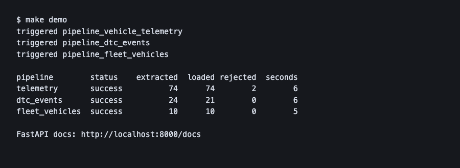
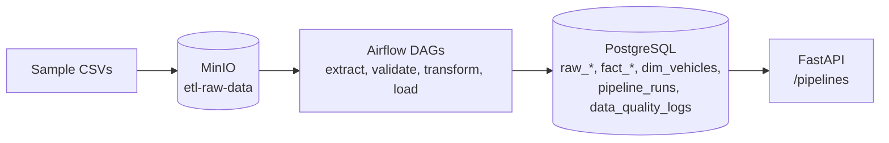

# fleet-telematics-etl

A personal project: three Airflow pipelines that load messy vehicle telematics CSVs from MinIO (S3 compatible) into PostgreSQL, with data quality checks and a FastAPI status API. For data engineers who want to see a small orchestrated pipeline end to end.

Topics: `airflow`, `etl`, `data-engineering`, `fastapi`, `postgresql`, `minio`, `docker-compose`, `python`



## Results

All data is small and generated for this repo. Nothing here ran against real fleets.

| What | Result | Command |
|---|---|---|
| Telemetry pipeline, 74 sample rows | 74 loaded, 1 row flagged as outlier, 5 s | `make demo` |
| DTC events pipeline, 24 sample rows | 21 loaded (3 duplicate deliveries dropped), 4 s | `make demo` |
| Fleet vehicles pipeline, 10 sample rows | 10 loaded, 4 s | `make demo` |
| Validate 100,000 generated telemetry rows | 0.20 s (about 490,000 rows/s) | `make eval` |
| Transform 100,000 rows | 0.24 s (about 420,000 rows/s) | `make eval` |
| Upsert 100,000 rows into PostgreSQL | 6.6 s (about 15,000 rows/s) | `make bench-load` |
| Peak memory of the benchmark process | 275 MB | `make bench-load` |
| Unit and API tests | 52 pass | `make test` |

The benchmark numbers come from one run on a 16 GB Apple silicon laptop with other containers running, so they move by about 2x between runs. The latest run is saved in `results/benchmark.json`. The Airflow run times in the first three rows include task scheduling overhead, not just the work.

In `pipeline_runs`, `records_rejected` counts rows that failed a quality check, summed over checks. Those rows are still loaded, flagged with `is_outlier`, so a single bad row can count twice (the telemetry sample shows 2 for 1 flagged row).

## How it works



- Each DAG finds the newest file under its MinIO prefix, validates it, transforms it with pandas, and upserts it.
- Validation writes one row per check to `data_quality_logs`. A missing required column fails the run. Range and format failures are logged and the rows are flagged.
- Raw rows land in `raw_*` tables, cleaned rows in `fact_telemetry`, `fact_dtc_events` and `dim_vehicles`.
- Every run writes a `pipeline_runs` row. The FastAPI service reads it, so you can check status without database access.
- Tasks retry 3 times with a 5 minute delay and call a failure callback that logs a structured alert.

## Design choices

- **Flag outliers, do not drop them.** A speed of 9999 mph is a sensor fault, but the row is still evidence. It loads with `is_outlier = TRUE`.
- **Hand-written pandas checks, not Great Expectations.** For single files of tens of thousands of rows they run in well under a second and the failure messages are easy to read. A schema library would make sense once checks multiply.
- **Upserts keyed on a business id** (`record_id`, `event_id`, `vin`). Re-running a file is safe for the curated tables. The raw tables are append only, so a re-run adds raw rows tagged with the new run id.
- **A plain retry loop for MinIO downloads** instead of a retry library. It is three lines and easy to step through.
- **MinIO and PostgreSQL stand in for S3 and Redshift.** The code only changes connection settings. I have not deployed it to AWS, so I call it deployable by configuration, not deployed.

## Run it

Needs Docker and `python3` on your PATH. The five containers used about 1.6 GB of memory in my run (`docker stats`). No API keys.

```bash
git clone https://github.com/Srijareddy123/fleet-telematics-etl.git
cd fleet-telematics-etl
make demo
```

This copies `.env.example` to `.env`, starts PostgreSQL, MinIO, Airflow (webserver and scheduler) and the API, uploads the sample files, triggers the three DAGs and prints the table above. First run builds images and takes a few minutes.

If a host port is taken, change the `*_HOST_PORT` values in `.env`.

| Service | URL | Login |
|---|---|---|
| Airflow | http://localhost:8080 | admin / admin |
| MinIO console | http://localhost:9001 | minioadmin / minioadmin123 |
| API docs | http://localhost:8000/docs | none |

```bash
make down    # stop
make clean   # stop and delete all data
```

## Tests

```bash
python3 -m venv .venv && . .venv/bin/activate   # Python 3.12 or 3.13
pip install -r requirements.txt
make test    # 52 tests: transforms, validators, loader helpers, API with a fake database
make lint    # ruff
make eval    # throughput benchmark, no Docker needed
```

Use Python 3.12 or 3.13 for the tests and install: Python 3.14 fails on the psycopg2-binary pin. CI runs lint, tests and the benchmark on Python 3.12 and 3.13. The Docker images use Python 3.11 because Airflow 2.9 ships with it.

## What I'd do next

- Process every new file under a prefix, not just the newest one, and add a backfill DAG.
- Use a connection pool in the loader. Today each batch opens its own connection.
- Count distinct rejected rows instead of summing failures per check.
- Wire the Slack and email alert helpers, which are commented out in `etl/monitoring/alerts.py`.
- Add an integration test that runs a DAG against real PostgreSQL and MinIO in CI.

## More

Repo description: Airflow, MinIO, PostgreSQL and FastAPI ETL for vehicle telematics sample data, run locally with Docker Compose.
