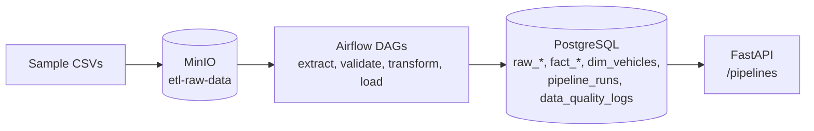

# Details

## Full results

All data is small and generated for this repo. Nothing here ran against real fleets.

| What | Result | Command |
|---|---|---|
| Telemetry pipeline, 74 sample rows | 74 loaded, 1 row flagged as outlier, 4 to 6 s | `make demo` |
| DTC events pipeline, 24 sample rows | 21 loaded (3 duplicate deliveries dropped), 4 to 6 s | `make demo` |
| Fleet vehicles pipeline, 10 sample rows | 10 loaded, 4 to 6 s | `make demo` |
| Validate 100,000 generated telemetry rows | 0.27 s (about 370,000 rows/s) | `make eval` |
| Transform 100,000 rows | 0.31 s (about 330,000 rows/s) | `make eval` |
| Upsert 100,000 rows into PostgreSQL | 7.1 s (about 14,000 rows/s) | `make bench-load` |
| Peak memory of the benchmark process | 310 MB | `make bench-load` |
| Unit and API tests | 52 pass | `make test` |

The benchmark numbers come from one run on a 16 GB Apple silicon laptop with other containers running, so they move by about 2x between runs. The latest run is saved in `results/benchmark.json`. The Airflow run times in the first three rows moved between 4 and 6 s across runs and include task scheduling overhead, not just the work.

In `pipeline_runs`, `records_rejected` counts rows that failed a quality check, summed over checks. Those rows are still loaded, flagged with `is_outlier`, so a single bad row can count twice (the telemetry sample shows 2 for 1 flagged row).

## How it works, more detail

- Range and format failures are logged and the rows are flagged. A missing required column fails the run.

## Design choices, in full

- **Flag outliers, do not drop them.** A speed of 9999 mph is a sensor fault, but the row is still evidence. It loads with `is_outlier = TRUE`.
- **Hand-written pandas checks, not Great Expectations.** For single files of tens of thousands of rows they run in well under a second and the failure messages are easy to read. A schema library would make sense once checks multiply.
- **Upserts keyed on a business id** (`record_id`, `event_id`, `vin`). Re-running a file is safe for the curated tables. The raw tables are append only, so a re-run adds raw rows tagged with the new run id.
- **A plain retry loop for MinIO downloads** instead of a retry library. It is three lines and easy to step through.
- **MinIO and PostgreSQL stand in for S3 and Redshift.** The code only changes connection settings. I have not deployed it to AWS, so I call it deployable by configuration, not deployed.
